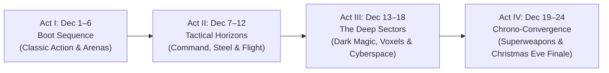
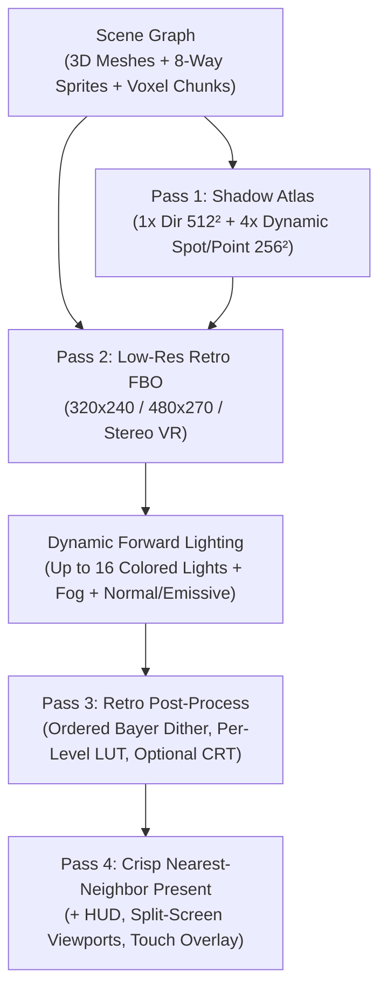
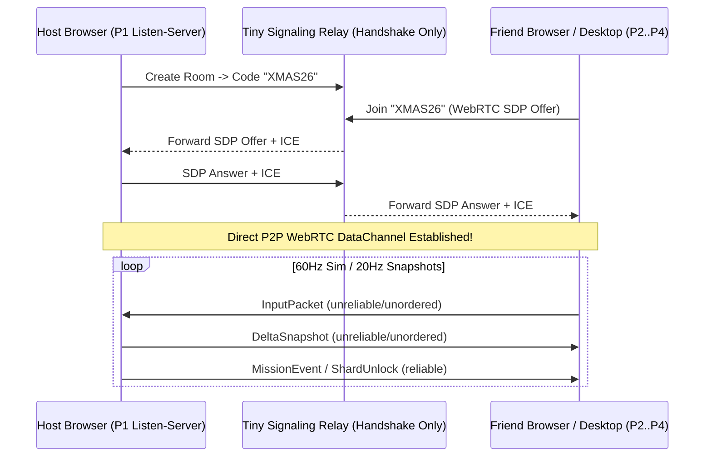

# ŚWIĘTA 2026: The Grand Hall of 24 Portals
### Complete Game Design, 24-Game Research Catalogue & Technical Architecture Concept

> **Repository:** `stbange/swieta2026` (`main` branch for development, `gh-pages` branch for automated Web/WebXR playtesting)  
> **Licenses:** Code — **MIT License** (`LICENSE`) | Art, Audio, Levels & Narrative — **CC BY 4.0** (`LICENSE-ART`)  
> **Tech Stack:** C11 · SDL3 · OpenGL 3.3 Core / OpenGL ES 3.0 (WebGL2) · Emscripten · WebXR · WebRTC DataChannels  
> **Engineering Standards:** OpenSpec Spec-Driven Development · ≥95% Unit Test Coverage · Automated Headless & Browser Game Tests

---

## 1. Executive Vision & Pillars

**Święta 2026** (working subtitle: *The Grand Hall of 24 Portals*) is a retro-3D first-person advent calendar game built as a love letter for a circle of friends who grew up playing PC and console classics together 25 years ago (1993–2000).

Each day from **December 1 to December 24, 2026**, one new portal inside a warm, festive, candlelit 3D Grand Hall unfreezes. Stepping through transports 1–4 players (solo, local split-screen, or online multiplayer) into a self-contained **~20-minute first-person adventure** paying loving homage to a defining game of the 1990s.

### Core Design Pillars
1. **Unified Core, Wildly Distinct Flavors:** Players always retain intuitive first-person fundamentals (move, aim, shoot/use, solve environmental puzzles), so they never have to relearn a whole control scheme from scratch. Yet every single portal injects **2–3 unmistakable mechanics, weapons, and items** from its inspiration—whether that is skiing with a Spinfusor (*Tribes*), terraforming voxel canyons from a flying carpet (*Magic Carpet 2*), managing BattleMech reactor heat (*MechWarrior 2*), or converting enemies with a "Wololo" staff (*Age of Empires*).
2. **Tactile Retro 3D Aesthetics:** Crisp low-resolution rendering (`320×240` to `480×270` internal framebuffer, nearest-neighbor upscaled) uniting **low-poly 3D meshes**, **8-direction billboard sprites**, and **destructible/sculpted voxels** under a single **modern-retro dynamic lighting and real-time shadow pipeline**.
3. **Built to Play Together Anywhere:** Zero-install browser playtesting via GitHub Pages (`gh-pages`), seamless mobile touch controls, stereoscopic WebXR VR support, native Windows/Linux builds, local 2–4 player split-screen, and frictionless room-code WebRTC multiplayer.
4. **Original Homage & Clean Licensing:** All code is **MIT** and all assets (textures, voxels, sprites, meshes, tracker/FM music, SFX, writing) are originally created under **CC BY 4.0**. Every world is an unmistakable, affectionate pastiche with original character/weapon/place names—no ripped assets or trademarked IP.

---

## 2. Meta-Story & The Grand Festive Hall

### 2.1 The Meta-Story: *The LAN Before Christmas (1999 → 2026)*
On **Christmas Eve 1999**, a group of friends gathered for an all-night basement holiday LAN party powered by a jury-rigged beige tower server nicknamed **THE YULE CORE (`NODE-24`)**. Loaded with 24 beloved games, the server was humming at full tilt when a freak Y2K-eve power surge hit at midnight. Instead of frying the hard drives, the surge compressed the collective joy and muscle memory of those 24 worlds into a dormant pocket winter dimension.

Twenty-seven winters later, on **December 1, 2026**, the Yule Core boots back up—but a rogue archival daemon called **KRAMPUS.EXE** (*"The Defragmenter"*) has infiltrated the drive. Convinced that chaotic old games are "inefficient nostalgia," KRAMPUS.EXE has frozen all 24 sectors behind icy portal locks and begun compressing their vibrant worlds into sterile, monochrome grey wireframe cubes before **24.12.2026 23:59**.

Players step into the Grand Festive Hall as **The Archivist(s)**—awakened by **SANTA-BIOS** (a cheerful, slightly glitchy CRT snowman terminal built from the LAN party's old IRC bot). Each day in December, SANTA-BIOS manages to thaw **one portal** for 24 hours of access (and once thawed, it stays open permanently). Entering each realm, players must defeat KRAMPUS.EXE's corruption, experience a 20-minute playable memory of that classic game, and recover its glowing voxel **Memory Shard** to re-slot into the Grand Yule Tree.

### 2.2 Four-Act Advent Structure



- **Act I (Dec 1–6 — *Boot Sequence*):** Restoring foundational FPS & adventure shards; KRAMPUS.EXE treats you as a harmless background process. Climax on **Dec 6 (St. Nicholas Day)** in the *Doom* homage cathedral.
- **Act II (Dec 7–12 — *Tactical Horizons*):** KRAMPUS.EXE locks down heavy war machines, zero-G mines, and strategy battlefields; players reclaim command tools, flight, and physics mastery.
- **Act III (Dec 13–18 — *The Deep Sectors*):** The virus corrupts fantasy realms, cyberpunk megacities, and orbital AI cores—forcing players to wield voxel destruction, magic, Force-like telekinesis, and cyberspace dives.
- **Act IV (Dec 19–24 — *Chrono-Convergence*):** With 18+ shards restored, the Grand Hall blazes with festive light. KRAMPUS.EXE attempts a temporal overwrite across sci-fi superweapons, culminating on **Dec 24 (Christmas Eve)** in the *Red Alert* Chrono-Fortress, where players use a Chronosphere to rewind the 1999 crash, shatter KRAMPUS.EXE, and ignite the eternal LAN-party Christmas celebration.

### 2.3 The Grand Festive Hall (3D Hub World)
- **Layout:** A soaring timber-and-stone winter cathedral with stained-glass CRT windows, a roaring dynamic-lit voxel fireplace (casting flickering shadows across the floor), a central **24-foot Voxel Evergreen Tree**, and **4 themed Wing Alcoves** holding 6 ornate stone-and-neon portals each.
- **Living Hub Progression:**
  - **24 Tree Ornaments & Fairy Lights:** Every Memory Shard returned snaps onto the Tree, increasing warm golden hall lighting and thawing frost from the ceiling murals.
  - **Layered Festive Soundtrack:** The Hall starts as a lonely music-box melody; each restored shard adds a retro synth/tracker instrument (bassline, sleigh-bell arpeggio, FM brass, chiptune lead) until all 24 layers harmonize on Christmas Eve.
  - **Trophy Shelves & Mini-Toys:** Completing a portal places an interactive souvenir in the Hall (e.g., a toy Spinfusor target range, a harmless Shrink-Ray snowglobe, a flickering CRT displaying 1999 LAN chat logs written for your friends).
  - **Multiplayer Lounge:** Friends joining your session spawn right beside the fireplace as customizable retro low-poly/voxel avatars wearing Santa hats and classic gamer gear; stepping into a portal together launches co-op immediately.
- **Calendar Gate & Playtest Mode:**
  - **Standard Advent Mode:** Uses date check (`2026-12-01` .. `2026-12-24`)—locked portals show frost crystals, a glowing countdown timer (`UNLOCKS IN 03d 14h`), and a teased silhouette peek through the frosted glass.
  - **Playtest / Developer / Post-Holiday Mode:** Toggleable via URL flag (`?unlock=all`), CLI flag (`--unlock-all`), or Host Lobby setting so you and your friends can playtest every finished portal on `gh-pages` before December and replay freely after Christmas.

---

## 3. Complete 24-Day Advent Portal Catalogue

### 3.1 Master Advent Calendar Overview

| Day | Inspiration (Year) | Portal Title (Homage) | Visual Hallmark | 3 Signature Mechanics / Weapons / Items | Memory Shard |
|---:|---|---|---|---|---|
| **01** | Duke Nukem 3D (1996) | *Neon Strip '96* | Build-style urban neon, sprites, interactive props | Shrinker + Stomp, Remote Pipebombs, Jetpack / Holo-Decoy | Golden Shades |
| **02** | Tomb Raider (1996) | *Vault of the Pixel Sun* | Blocky grid-temple 3D, dynamic torch flares | Dual Pistols (auto-lock acrobatic), Ledge Climb/Shimmy, Push-Block & Flooded Cistern Switches | Scion Prism |
| **03** | Counter-Strike (1999) | *de_yule_dust* | Crisp dusty sandstone 3D, sharp tactical shadows | Buy-Crate Economy, Recoil-Pattern Rifles + Flashbang/Smoke, Bomb Plant/Defuse Kit | Defusal Pliers |
| **04** | Quake (1996) | *Slipgate of Brass & Rust* | Gothic brown/brass true-3D, flickering lightmaps | Rocket Jump Physics, Quad Damage Rune, Thunderbolt / Nailgun | Slipgate Rune |
| **05** | Blood (1997) | *Carnival of the Damned* | Moody Build-engine horror, crimson firelight | Flare Gun (DoT burn), Alt-Fire TNT Bundles, Voodoo Doll + Pitchfork | Crimson Chalice |
| **06** | Doom (1993) | *E1M24: Brimstone Hangar* | Fast sprite hordes, blinking corridors, colored doors | Super Shotgun & Chainsaw/BFG-homage, 3-Color Keycard Labyrinth, Barrel Chain-Reactions | Hellfire Key |
| **07** | Half-Life (1998) | *Sector C: Cascade* | Industrial GoldSrc labs, tram intro, hazard lighting | Crowbar + Crate Physics, HEV Wall Chargers, Tau Gauss Jump-Cannon & Snark Swarm | Resonance Crystal |
| **08** | Command & Conquer (1995) | *Crystal Dawn Basin* | Sunbaked desert, glowing green crystal fields | Toxic Harvestable Crystal Fields, Orbital Ion Beacon, Power-Grid Sabotage vs. Laser Obelisks | Ion Core |
| **09** | MechWarrior 2 (1995) | *Trial of Iron Snow* | Flat-shaded/low-poly tundra, cockpit HUD wireframe | Reactor Heat Gauge & Override, Torso Twist + Jump Jets, Limb-Targeted Lock-On LRMs & PPCs | Gyro Matrix |
| **10** | Descent (1995) | *Sublevel Zero-G* | True 3D twisting mine tunnels, glowing robot lights | Full 6-DOF Zero-G Flight, Friendly Guide-Bot, Reactor Core Meltdown Timed Escape | Fusion Cell |
| **11** | Starsiege: Tribes (1998) | *Glacier Spinfusor* | Rolling sunlit snow hills, crisp skybox fog | Frictionless Slope Skiing + Jetpack, Disc Spinfusor (mid-air inheritance), Deployable Turret/Inv Pack | Tribal Flag |
| **12** | Warcraft II (1995) | *Tides of Timber & Oil* | Bold storybook fantasy palette, dynamic fog-of-war | Fog-of-War Scout Beacons, Lumber/Gold/Oil Squad Wheel (summon Knights/Ballistae), Bloodlust & Polymorph | Runic Crest |
| **13** | Diablo (1996) | *Cathedral of Ash* | Deep shadow radius, warm candlelight, gothic stone | Town Portal Safe-Room Scroll, Shrine Risk/Reward & Randomized Loot, Cleaver Boss & Fireball Staff | Soulstone Ember |
| **14** | Secret of Mana (1993) | *Grove of the Ring* | Lush pastel 16-bit palette translated to vibrant voxels | Ring Command Radial Menu, 100% Charge-Gauge Sword/Whip Gap-Swing, Elemental Spirit Spells | Mana Seed |
| **15** | Magic Carpet 2 (1995) | *Dunes of the Nether* | Deformable voxel canyons, atmospheric distance fog | Flying Carpet + Dual-Hand Spells, Terrain Crater/Volcano Terraforming, Mana Pearl Tether to Castle | Djinn Pearl |
| **16** | Jedi Knight (1997) | *Valley of the Saber* | Towering Sith-engine chasms, glowing blade light | Energy Saber Melee & Blaster Deflection, Force Push/Pull/Jump Puzzles, Light/Dark Choice | Kyber Shard |
| **17** | Syndicate Wars (1996) | *Rain Over Sector 9* | Rainy cyberpunk voxel skyscrapers, neon reflections | Destructible Voxel Buildings (Gauss/Orbital Rain), Persuasion Mind-Control Beam, Cyber-Adrenaline Chip | Neural Chip |
| **18** | System Shock (1994) | *Citadel Deck Zero* | Claustrophobic hi-tech decks + neon wireframe cyber | Audio Logs & Circuit Junction Puzzles, 6-DOF Wireframe Cyberspace Dives, Toggleable Cyber Implants | Neural Override |
| **19** | X-COM: UFO Defense (1994) | *Nightfall Crash Site* | Pitch-black farmland lit by flares & plasma glow | Tactical Slow-Mo Time-Unit Burst, Waypoint-Guided Blaster Launcher, Psi-Amp & Motion Scanner | Elerium Orb |
| **20** | Unreal (1998) | *Spire of Floating Waters* | Vivid colored dynamic lights, alien sky-temple | ASMD Shock Rifle (Orb + Beam Shock Combo!), Flak Cannon & Dispersion Pistol, Translator Lore Tablets | Nali Star |
| **21** | StarCraft (1998) | *Outpost Koprulu* | Gritty metallic bunkers, purple alien creep, blue pylons | Stimpack (HP→Fire-Rate), Pylon Power-Field Puzzles, Cloaked Ghost Tactical Nuke Laser-Painter | Khaydarin Shard |
| **22** | Age of Empires (1997) | *Citadel of Four Ages* | Mediterranean marble, terracotta voxels, sunlit water | Mid-Level Tech-Age Upgrades (Stone→Iron), "Wololo" Conversion Staff, Relic Capture & Wonder Defense | Golden Relic |
| **23** | Total Annihilation (1997) | *Metal & Energy Front* | Metallic alloy plains, 3D articulated mech wreckage | Commander D-Gun (one-shot energy beam), Nano-Lathe Reclaim & Build Beam, Live Metal/Energy Economy | Commander Core |
| **24** | C&C: Red Alert (1996) | *Operation: Chrono-Eve* | Snowbound Tesla fortress, electric blue arcs, crimson banners | Tesla Coil / Shock Cannon, Iron Curtain Invulnerability, Chronosphere Phase-Shift & Final KRAMPUS.EXE Boss | The Yule Star |

---

### 3.2 Detailed Level Blueprints (20 Minutes Each)

Every level follows a disciplined **4-Beat 20-Minute Pacing Structure**:
- **Beat A (0–4 min):** Atmospheric entry, visual gag/homage, acquire Signature Mechanic/Weapon #1.
- **Beat B (4–10 min):** Mid-map exploration & puzzle using Mechanic #2 + 1 hidden retro secret room.
- **Beat C (10–16 min):** Escalation set-piece combining Mechanics #1–#3.
- **Beat D (16–20 min):** Signature boss/escape climax, claim the **Memory Shard**, exit back to the Grand Hall.

---

#### ACT I — *Boot Sequence: Classic Action & Arenas* (Dec 1 – Dec 6)

##### Day 1 (Dec 1) — **Duke Nukem 3D** (1996, 3D Realms) → *Neon Strip '96*
- **Research:** Built on Ken Silverman's **Build Engine** (2.5D sectors, sloped floors, overlapping non-simultaneous rooms, crisp 256-color sprites, interactive world props—mirrors, switches, cracked walls, toilets, cinema screens). Known for wisecracking 90s action-movie parody, vertical exploration, and inventive gadgets.
- **Homage & Visuals:** A snowy nighttime retro-Hollywood strip ("Yule Cinema," "Pixel Arcade," rooftop billboards) with bright neon dynamic lights, breakable voxel windows, cracked walls hiding secrets, and chunky 8-direction alien trooper sprites.
- **Signature Mechanics, Weapons & Items:**
  1. **Shrink-Ray + Mighty Boot Stomp:** Shrink tough armored Boar-Cops into tiny squeaking sprites, then stomp them flat (also used to slip through tiny vent puzzles if self-reflected via a mirror!).
  2. **Remote Pipebombs & Laser Tripmines:** Toss bouncing voxel pipebombs through vents and detonate on demand to blast cracked walls and ambushes.
  3. **Jetpack & Holo-Decoy:** Fuel-limited jetpack for rooftop verticality + deployable hologram decoy that draws alien fire away while you flank.
- **Enemies & 20-Min Mission:** Alien Jetpack Troopers, Pig-Guard Enforcers, floating Tentacle-Brains. Restore power to the Neon Cinema projector (which KRAMPUS.EXE hijacked to broadcast grey static), blast open the backstage vault, defeat the Rooftop Battle-Mech boss, and punch the big red *Nuke-Exit* button to grab the **Golden Shades** shard.

##### Day 2 (Dec 2) — **Tomb Raider** (1996, Core Design) → *Vault of the Pixel Sun*
- **Research:** True 3D block-grid rooms (3D low-poly geometry with bold geometric ledges, pools, traps, and sparse atmospheric silence punctuated by sudden musical stings). Gameplay centered on methodical platforming, switch/key/push-block puzzles, swimming, and acrobatic dual-pistol combat.
- **Homage & Visuals:** A sunken Peruvian/Atlantean snow-dusted temple built on readable low-poly stone blocks with dynamic flickering wall torches, reflective water cisterns, and rolling boulder traps.
- **Signature Mechanics, Weapons & Items:**
  1. **Infinite Dual Pistols with Acrobatic Lock-On:** Side-flip/back-flip dodge bursts while soft-locking onto darting predators.
  2. **Ledge Grab, Shimmy & Push-Block Grid Puzzles:** First-person mantling with tactile hand animations, pulling movable stone blocks onto pressure plates, and raising/lowering water levels in a central cistern.
  3. **Throwable Magnesium Flares:** Toss burning green flares into dark tombs (showcasing real-time moving point-light shadows!) to spot concealed wall switches and spike pits.
- **Enemies & 20-Min Mission:** Cave Wolves, Giant Bats, Stone Guardians, and a surprise low-poly **T-Rex** encounter in a hidden valley courtyard! Solve the 3-level Cistern Water Puzzle, outrun the boulder corridor, claim the **Scion Prism**, and escape via the sunlit waterfall.

##### Day 3 (Dec 3) — **Counter-Strike** (1999, Minh Le & Jess Cliffe / Valve) → *de_yule_dust*
- **Research:** Born as a *Half-Life* mod (GoldSrc engine); crisp sunlit urban/desert architecture, clean sightlines, lethal low-TTK tactical shooting, spray-pattern mastery, round economy, utility grenades, and objective-focused bomb defusal.
- **Homage & Visuals:** A warm sandstone & winter-decorated bazaar inspired by classic `de_dust` / `de_aztec` geometry—arches, catwalks, underpass tunnels, wooden crates, and crisp directional sunlight with harsh archway shadows.
- **Signature Mechanics, Weapons & Items:**
  1. **Tactical Buy-Zone Crate & Cash Economy:** Eliminating rogue bots and securing checkpoints awards cash (`$`) to buy upgraded gear at supply crates (Deagle-style heavy pistol, Burst Carbine, scoped Bolt-Sniper, Kevlar Vest).
  2. **Movement-Accuracy & Spray-Pattern Gunplay + Utility Grenades:** Standing/crouching tightens crosshair spread; Flashbangs blind enemy squads (whiteout + ear-ring VFX) and Smoke Grenades block sniper corridors.
  3. **C4 Bomb Defusal / Plant Sequence:** Clear Bombsites A and B, hold E with the **Defuse Kit** (cuts defusal time in half!) while co-op teammates or cover hold off counter-rushes.
- **Enemies & 20-Min Mission:** Tactically flanking KRAMPUS-Syndicate Troopers (who call out footsteps and hold angles). Execute a 3-stage tactical breach across Long, Tunnel, and Mid to defuse two corrupted data-bombs and extract the **Defusal Pliers** shard.

##### Day 4 (Dec 4) — **Quake** (1996, id Software) → *Slipgate of Brass & Rust*
- **Research:** The landmark **true 3D BSP** engine with precalculated lightmaps, 3D polygonal enemies (`.mdl`), moody medieval-industrial brown/copper palette, dark ambient soundscape, verticality, and kinetic movement physics (strafe-jumping, rocket-jumping).
- **Homage & Visuals:** Weathered copper arches, spiked portcullises, lava moats, stained-glass slipgates, and dynamic flickering torchlight over chunky low-poly 3D monsters and angular weapon models.
- **Signature Mechanics, Weapons & Items:**
  1. **Rocket Launcher & Rocket Jumping:** Full self-knockback physics tuned for launching to high ledges, secret armor alcoves, and upper walkways (with reduced self-damage on jump pads).
  2. **Quad Damage Rune (4× Power):** Glowing blue voxel rune that bathes the room in dynamic blue light and turns your **Super Nailgun** and **Thunderbolt** (continuous lightning beam—careful not to discharge underwater!) into room-clearing devastation.
  3. **Bunny-Hop / Strafe Acceleration & Slipgate Teleporters:** Air-control momentum bonus + instant-portal telefragging of gatekeepers.
- **Enemies & 20-Min Mission:** Chainsaw-toting Ogre-Brutes (bouncing grenades), leaping Fiend-Beasts, armor-plated Death-Knights, and a towering **Shambler-homage** lightning beast guarding the final **Slipgate Rune**.

##### Day 5 (Dec 5) — **Blood** (1997, Monolith Productions) → *Carnival of the Damned*
- **Research:** Build-engine masterclass in dark gothic horror + campy B-movie humor; first FPS to popularize **secondary/alternate fire modes** on almost every weapon, darkly inventive arsenal, and ruthless cultist firefights.
- **Homage & Visuals:** A foggy Victorian railway station leading into a cursed winter carnival—creaking Ferris wheel silhouettes, crimson-lit crypts, destructible stained glass, and expressive sprite enemies.
- **Signature Mechanics, Weapons & Items:**
  1. **Flare Gun & Aerosol Flamethrower:** Primary flare sticks to enemies and burns them over time (alt-fire starburst spreads flames); aerosol can shoots fire streams or turns into a thrown Molotov on alt-fire.
  2. **Dynamite (TNT) Bundles with Cooked Throw:** Hold to gauge throwing arc, or alt-fire to drop proximity/remote bundles—essential for blowing open crypt walls and clearing cultist packs.
  3. **Pitchfork & Voodoo Doll:** Classic 4-prong melee + eerie Voodoo Doll that stabs any targeted foe in line-of-sight (alt-fire drains doll energy for an AoE curse).
- **Enemies & 20-Min Mission:** Robed Lantern-Cultists (who toss dynamite back!), Shambling Axe-Ghouls, Winged Stone Gargoyles, and crawling Severed Hands. Board the haunted Ghost Train, unlock the Carnival Big Top, banish the Gargoyle Matriarch, and claim the **Crimson Chalice**.

##### Day 6 (Dec 6 — *St. Nicholas Day / Act I Climax*) — **Doom** (1993, id Software) → *E1M24: Brimstone Hangar*
- **Research:** The blueprint of FPS games: lightning-fast movement, crisp sprite-based demon roster with distinct infighting behaviors, non-linear interlocking corridors with colored keycards, blinking sector lights, nukage pits, and the unforgettable shotgun cadence.
- **Homage & Visuals:** Techbase steel corridors bleeding into gothic marble and glowing green slime pits—pulsing sector lights, crisp sprite monsters with dynamic glow from plasma fireballs, and crunchy low-res pixel skies.
- **Signature Mechanics, Weapons & Items:**
  1. **Double-Barrel Super Shotgun, Chainsaw & BFG-9000 Homage ("Yule-BFG"):** Iconic rhythmic reload punch, close-range stun-lock saw, and a giant green plasma orb that clears entire rooms via secondary tracer rays.
  2. **Red/Blue/Yellow Keycard Loop + Monster Infighting:** Interconnected hub-and-spoke techbase where dodging fireballs causes demons to brawl each other, plus explosive barrel chain reactions.
  3. **Berserk Pack & Radiation Suit:** Temporary red-tinted melee frenzy and glowing-slime immunity for secret shortcuts.
- **Enemies & 20-Min Mission:** Fireball Imps, Pink Charger-Beasts, floating One-Eyed Orbs, and a cybernetic **Horned Rocket-Titan** boss in the central reactor courtyard. Defeating it breaks KRAMPUS.EXE's Act I firewall and awards the **Hellfire Key**.

---

#### ACT II — *Tactical Horizons: Command, Steel & Flight* (Dec 7 – Dec 12)

##### Day 7 (Dec 7) — **Half-Life** (1998, Valve) → *Sector C: Cascade*
- **Research:** Heavily modified Quake engine (**GoldSrc**) pioneering seamless unbroken first-person storytelling, scripted environmental disasters, physics-crate puzzles, squad-tactic AI marines, and experimental sci-fi weapons.
- **Homage & Visuals:** An underground alpine research complex ("White Mesa") opening with a **90-second playable monorail tram ride** past flickering labs, sparking pipes, and panicking scientists before a resonance pulse shatters the test chamber.
- **Signature Mechanics, Weapons & Items:**
  1. **Crowbar & HEV Suit Wall Chargers:** Smash vents, crates, and leaping parasites; recharge health & suit power at humming wall stations (classic "beep-boop" audio homage).
  2. **Tau Gauss Cannon (Charged Recoil Jump & Wall-Pierce):** Overcharge beams to pierce thin steel walls or launch yourself across broken elevator shafts (don't overhold or it overloads!).
  3. **Snark Bug-Swarm & Laser Tripmines:** Toss tiny chittering alien beetles that chase enemies around corners—watch out if they run out of targets and turn on you!
- **Enemies & 20-Min Mission:** Leaping Head-Crabs, Barnacle ceiling tongues (look up!), Bolt-Shooting Alien Slaves, and flanking Hazmat Commandos. Survive the Cascade, restart the Rocket Test Pit to fry a giant Tentacle-Hydra blocking the silo, and retrieve the **Resonance Crystal**.

##### Day 8 (Dec 8) — **Command & Conquer** (1995, Westwood Studios) → *Crystal Dawn Basin*
- **Research:** Defined modern RTS with sidebar construction, harvesters gathering glowing green **Tiberium** crystals (which hurt infantry!), FMV-style mission briefings, GDI vs. Nod asymmetry, the lethal **Obelisk of Light**, and the **Ion Cannon**.
- **Homage & Visuals:** Sun-baked desert canyon dotted with glowing emerald voxel crystal patches (casting eerie green dynamic floor light!), sandbag bunkers, and low-poly tracked harvesters rumbling between refineries.
- **Signature Mechanics, Weapons & Items:**
  1. **Toxic Crystal Fields & Harvester Escort:** Stepping into green crystals damages unprotected boots (until you grab a Bio-Suit), while escorting your giant voxel Harvester to the Refinery generates credits to call in supply drops and friendly APC/Mammoth support.
  2. **Power-Grid Sabotage vs. Laser Obelisks:** Towering dark monoliths charge up with a rising hum and vaporize anything in range—you must flank and blow up enemy **Power Plants** to put the base in *"Low Power"* mode and silence the Obelisks!
  3. **Orbital Ion Cannon Target Designator:** Paint a hardened enemy Temple bunker with a laser beacon and watch a blinding blue sky-beam vaporize it in voxel rubble.
- **Enemies & 20-Min Mission:** Flame-Troopers, Stealth-Cloaked Recon Bikes, Buggy patrols, and fortified Laser Obelisks. Starve the enemy refinery, drop their power grid, call down the Ion strike on the corrupted Temple, and secure the **Ion Core**.

##### Day 9 (Dec 9) — **MechWarrior (MechWarrior 2)** (1995, Activision) → *Trial of Iron Snow*
- **Research:** Iconic 31st-century BattleMech cockpit simulator: flat/Gouraud-shaded low-poly mechs striding across stark alien canyons, crisp wireframe targeting HUD, separate leg-heading vs. torso-twist aiming, weapon groups, **heat management**, and component damage.
- **Homage & Visuals:** You pilot a 65-ton retro **Timber-Yule Exo-Mech** across a moonlit frozen crater canyon with stark geometric cliffs, crisp cockpit strut framing (incredible in WebXR!), radar blips, and glowing laser/PPC trails.
- **Signature Mechanics, Weapons & Items:**
  1. **Reactor Heat Gauge & Override:** Firing heavy **PPCs / Pulse Lasers** spikes heat; hitting 100% triggers auto-shutdown (unless you hit *Override* at risk of internal damage)—standing in icy glacial streams cools your reactor twice as fast!
  2. **Independent Torso Twist + Jump Jets:** Stride along canyons while twisting your upper torso to strafe-fire, and burst Jump Jets to hop over volcanic ridges and rain down fire.
  3. **Subsystem Targeting & Lock-On LRM Salvos:** Lock onto an enemy mech's legs to cripple its speed or its weapon-arm to disarm it, then fire arcing 10-missile LRM volleys.
- **Enemies & 20-Min Mission:** Light Scout-Walkers, Missile-Carrier Hovertanks, Laser Turrets, and a dramatic 1-on-1 *Trial of Position* duel against a twin-PPC Assault Mech guarding the **Gyro Matrix**.

##### Day 10 (Dec 10) — **Descent** (1995, Parallax Software) → *Sublevel Zero-G*
- **Research:** Pioneered true **6-Degrees-of-Freedom (6-DOF)** indoor tunnel flight in a texture-mapped 3D portal-cube engine—no fixed "up," 3D wireframe automap, hostile mining robots, hostage rescue, and the iconic **destroy-the-reactor-and-escape** countdown.
- **Homage & Visuals:** Interlocking octagonal asteroid mine shafts with warning hazard stripes, forcefield doors, glowing lava vents, and faceted 3D hovering robots illuminated by dynamic laser bolts and flares.
- **Signature Mechanics, Weapons & Items:**
  1. **Full 6-DOF Thruster Flight (+ Auto-Level Assist Option):** Pitch, yaw, roll, slide up/down/left/right freely (with an optional comfort auto-horizon mode for casual players and VR users).
  2. **Friendly Guide-Bot & Quad-Laser / Homing Missiles:** Release the trapped voxel Guide-Bot—it zips ahead with a headlamp, illuminating dark tunnels and leading you to keys, hostages, and the exit shaft; fire rechargeable Quad-Lasers + Concussion/Homing Missiles.
  3. **Reactor Core Meltdown Escape:** Blow up the central spinning Reactor Core to trigger a **60-second mine self-destruct countdown** with shaking tunnels, exploding bulkheads, and a frantic boost sprint to the emergency exit chute!
- **Enemies & 20-Min Mission:** Mining Class-1 Drones, cloaked Lifter-Bots, Thief-Bot (steals a powerup until you chase it down!), and Heavy Vulcan-Mechs. Rescue 4 trapped LAN-Technician pods, melt the Reactor, escape with seconds to spare, and earn the **Fusion Cell**.

##### Day 11 (Dec 11) — **Tribes (Starsiege: Tribes)** (1998, Dynamix) → *Glacier Spinfusor*
- **Research:** Landmark outdoor team FPS famous for vast rolling heightfield terrain, **jetpacks**, emergent frictionless **skiing** down hills at 150+ km/h, projectile inheritance (**Spinfusor** discs), base generators, and Capture-the-Flag.
- **Homage & Visuals:** Sun-drenched rolling alpine snow-hills under crisp blue-violet skies, twin futuristic steel-and-glass mountain bases with glowing beacon towers and long-range distance fog.
- **Signature Mechanics, Weapons & Items:**
  1. **Frictionless Skiing + Jetpack Momentum:** Hold *Ski* on downslopes to eliminate friction and carve valleys at exhilarating speed, then tap *Jetpack* at hill crests to soar over enemy walls.
  2. **Spinfusor Disc Launcher & Chaingun:** High-impulse glowing blue energy discs that inherit player velocity—rewarding glorious mid-air ("Blue Plate Special!") hits and disc-jumping boosts.
  3. **Inventory Station & Deployable Pack:** Swap between Light (Scout/Ski), Medium, and Heavy armor at base stations, and drop portable Repair/Turret/Sensor packs to fortify your flag stand while attacking the enemy's Base Generator.
- **Enemies & 20-Min Mission:** Jetpack Blood-Eagle Raiders, Heavy Mortar-Juggernauts, and automated Base Turrets. Sabotage the enemy Generator to disable their forcefields, ski across the valley at breakneck speed to capture 3 corrupted Data-Flags (or defend in co-op CTF!), and claim the **Tribal Flag** shard.

##### Day 12 (Dec 12) — **Warcraft II: Tides of Darkness** (1995, Blizzard) → *Tides of Timber & Oil*
- **Research:** Crisp SVGA 2D fantasy RTS with iconic painted clarity, **Fog of War** (explored terrain stays dimmed while unobserved units vanish), 3-resource economy (Gold, Lumber, Oil), naval/air combat, and memorable spells (*Bloodlust*, *Blizzard*, *Polymorph*).
- **Homage & Visuals:** Storybook pine forests, snow-dusted timber keeps, golden mines, and dark coastal waters rendered with chunky painterly low-res textures and voxel pine trees—complete with an in-world **Fog-of-War Dark Cloud Wall** that clears dynamically as you explore!
- **Signature Mechanics, Weapons & Items:**
  1. **First-Person Banner Command & Resource Harvest:** Chop enchanted lumber / capture Gold Mines & Offshore Oil Rigs to fund your Keep, then point-and-command summoned **Footmen, Elven Archers, and Ballistae** directly in first-person!
  2. **Scout Zeppelin / Fog-of-War Clearing:** Launch hovering balloon scouts to peel back the black Fog-of-War shroud on your corner minimap and spot hidden enemy catapults.
  3. **Arcane Tome (Polymorph, Bloodlust & Blizzard):** Turn charging Ogre-Brutes into harmless fluffy voxel sheep, buff your squad with red *Bloodlust* frenzy, or call down an icy *Blizzard* shower.
- **Enemies & 20-Min Mission:** Axe-Throwing Trolls, Charging Grunts, Goblin Sappers (watch for suicide barrel runners!), and Fire-Breathing Drakes. Build up your coastal outpost, sink the enemy Juggernaut ship blocking the bay, storm the Obsidian Fortress, and claim the **Runic Crest**.

---

#### ACT III — *The Deep Sectors: Dark Magic, Voxels & Cyberspace* (Dec 13 – Dec 18)

##### Day 13 (Dec 13 — *3rd Advent*) — **Diablo** (1996, Blizzard North) → *Cathedral of Ash*
- **Research:** Gothic dark-fantasy action-RPG defined by a claustrophobic **light-radius** pushing back pitch darkness, acoustic guitar town sanctuary (*Tristram*), randomized magical loot & risky Shrines, **Town Portal** scrolls, and unforgettable dungeon dread (*The Butcher*).
- **Homage & Visuals:** Pitch-black Gothic stone cathedral descending into catacombs and lava-lit caves—your hero carries a warm dynamic **Light Radius** that flickers across pillars and casts long, ominous shadows from lurking skeleton sprites!
- **Signature Mechanics, Weapons & Items:**
  1. **Town Portal Scroll (Instant Sanctuary Loop):** Open a swirling blue portal anywhere to step back into the warm acoustic-guitar **Safe Square** (heal at the fountain, identify magic gear, refill red Health / blue Mana belt potions), then step right back in!
  2. **Randomized Magic Loot & Mysterious Shrines:** Chests and elites drop stat-rolled weapons (*"Blazing Bow of the Bear"*, *"Staff of Chain Lightning"*); touching cryptic Shrines grants permanent buffs—or hilarious curses!
  3. **Health/Mana Globe Belt + Spell Tomes:** Instant belt hotkeys (1–4) for potions plus Firewall & Chain Lightning spells that illuminate entire crypts.
- **Enemies & 20-Min Mission:** Fallen Imps (who scatter yelling when one dies), Skeleton Archers, Acid Spitters, and opening *that* blood-red chamber door to face **The Carver** (*"Fresh Pixels!"*) before descending to claim the **Soulstone Ember**.

##### Day 14 (Dec 14) — **Secret of Mana** (1993, Square) → *Grove of the Ring*
- **Research:** Lush 16-bit SNES action-RPG famous for seamless 3-player co-op, the iconic orbiting **Ring Command** menu, a rhythmic **100% Stamina/Charge Weapon Gauge** (preventing button mashing), utility weapons (Whip to swing across chasms, Axe to chop bushes), and adorable Elemental Spirits.
- **Homage & Visuals:** Sun-dappled emerald waterfalls, pastel mushroom glades, and crystal-tiled Mana Ruins rendered in bright, saturated voxel foliage and cheerful bouncing 2.5D sprites with warm sunbeams.
- **Signature Mechanics, Weapons & Items:**
  1. **Orbiting Ring Command Wheel:** Tap one button to spin an iconic 3D ring of crisp pixel icons around your view (slowing time in solo, real-time in MP) to swap weapons, eat Candy/Chocolate heals, or invoke Spirit Magic.
  2. **100% Attack & Charge Gauge + Utility Whip:** Swinging resets stamina to 0%—wait for the crisp *ding* at 100% for full damage, or hold to charge a spinning Level-2/3 super-strike! Use the **Chain Whip** to latch onto wooden posts and swing across waterfall chasms.
  3. **Elemental Spirit Magic & Weapon Orbs:** Summon **Aqua-Sprite** (Heal Water / Ice Freeze) and **Flame-Sprite** (Fireball) to solve elemental crystal switches; collect 2 Weapon Orbs to reforge your Rusty Blade at the Dwarf Blacksmith's anvil mid-level!
- **Enemies & 20-Min Mission:** Bouncing Rabite-Slimes, Mushroom Spores, Goblin Knights, and a multi-phase **Mantis-Ant Guardian** boss in the Mana Sanctum guarding the **Mana Seed**.

##### Day 15 (Dec 15) — **Magic Carpet 2: The Netherworlds** (1995, Bullfrog) → *Dunes of the Nether*
- **Research:** Revolutionary 1995 flying wizard shooter/strategy hybrid running on a fast deformable **voxel/heightfield terrain engine** with atmospheric fog, night/cavern worlds, dual-hand spellcasting, live terrain deformation (craters, volcanoes, canyons), **Mana Pearls**, and **Castle** construction.
- **Homage & Visuals:** A prime showcase for our engine's **deformable voxel terrain**! Soar over glowing twilight canyons and obsidian seas with thick mystical distance fog, dynamic fireball light illuminating valley walls, and rising voxel castles.
- **Signature Mechanics, Weapons & Items:**
  1. **Magic Carpet Flight & Dual-Hand Spellcasting:** Smooth hover-flight that glides naturally over terrain contours; Left Hand casts rapid **Fireballs / Lightning**, Right Hand casts tactical **Possess / Shield / Terrain Spells**.
  2. **Live Voxel Terraforming (Crater, Volcano & Raise-Earth):** Blast deep craters beneath rival wizards' towers to sink them into the sea, or raise a glowing voxel volcano that erupts lava pearls!
  3. **Mana Pearls & Balloon Castle Tether:** Slaying monsters drops shimmering Mana Pearls; cast *Possess* so floating hot-air balloons haul them back to expand your Voxel Castle (upgrading your spell power and acting as your respawn anchor).
- **Enemies & 20-Min Mission:** Fire-Breathing Wyverns, Stone Giants, Skeleton Archers, and 2 rival AI Wizards competing to claim the Nether Valley's mana. Sink their castles, reach 100% Equilibrium, and claim the **Djinn Pearl**.

##### Day 16 (Dec 16) — **Jedi Knight: Dark Forces II** (1997, LucasArts) → *Valley of the Saber*
- **Research:** True-3D **Sith Engine** famous for vertiginous architectural scale, the exhilarating debut of first-person **Lightsaber combat + blaster bolt deflection**, and RPG-like **Force Powers** (Jump, Speed, Push, Pull, Seeing, Light/Dark alignment).
- **Homage & Visuals:** Monumental Brutalist canyon citadels, suspended cargo walkways over bottomless foggy abysses, glowing blue/green/crimson plasma blade trails that cast real-time colored light onto walls and faces!
- **Signature Mechanics, Weapons & Items:**
  1. **Plasma Saber (Melee + Timed Blaster Deflection):** Swing directional slashes and auto/timed-deflect incoming enemy blaster bolts straight back into storm-trooper turrets!
  2. **Force-Echo Powers (Jump, Push, Pull & Sense):** Soar across massive chasms with Force Jump, shove armored guards off catwalks with Force Push, yank distant keys/weapons with Force Pull, and reveal hidden rune doors with Force Sense.
  3. **Light vs. Dark Alignment Shrine:** Midway through the Valley, choose between **Barrier/Heal** (Light) or **Chain-Arc/Grip** (Dark)—subtly tinting your blade glow and altering the final boss dialogue!
- **Enemies & 20-Min Mission:** Imperial-homage Troopers, Hover-Droids, Turret Batteries, and a climactic blade-clashing duel against a corrupted **Dark Archivist** inside the echoing Statue Chamber for the **Kyber Shard**.

##### Day 17 (Dec 17) — **Syndicate Wars** (1996, Bullfrog) → *Rain Over Sector 9*
- **Research:** Gritty isometric 3D cyberpunk action-strategy set in rain-soaked neon megacities; famous for **fully destructible 3D buildings**, the iconic **Persuadatron** mind-control gadget (amassing weaponized civilian crowds), cybernetic agent upgrades, and the absurdly destructive **Satellite Rain** / **Gauss Gun**.
- **Homage & Visuals:** Rain-slicked midnight cyberpunk streets built from **100% destructible voxel skyscrapers**, flashing neon holo-billboards (dynamic colored reflections on wet streets!), hovering retro spinners, and trench-coated agents.
- **Signature Mechanics, Weapons & Items:**
  1. **Fully Destructible Voxel Cityscape (Gauss Gun & Orbital Rain):** Blast structural pillars with the Gauss Gun or call down a blazing **Satellite Rain** beam to collapse entire enemy corporate towers into tumbling voxel debris!
  2. **Persuader-Tron Mind-Control Beam:** Emit a rhythmic hypnotic pulse that converts wandering citizens and light security guards into loyal trench-coated followers who pick up dropped weapons and fight alongside you.
  3. **Cyber-Adrenaline Chip Slider:** Toggle overclocked reflexes (speed + fire rate + shield regen at the cost of overheating stamina) to survive heavy corporate hit-squads.
- **Enemies & 20-Min Mission:** Rival Syndicate Agents, Cyber-Zealots, Armored Hover-Patrols, and Rooftop Rail-Snipers. Infiltrate the rain-soaked downtown grid, rally a persuaded squad, demolish the KRAMPUS Propaganda Spire, and extract the **Neural Chip**.

##### Day 18 (Dec 18) — **System Shock** (1994, Looking Glass Technologies) → *Citadel Deck Zero*
- **Research:** The foundational **immersive sim** aboard a haunted cyberpunk space station run by rogue AI **SHODAN**. Known for mouse-driven HUD/implants, multi-floor exploration, environmental storytelling via **Audio Logs**, circuit-routing **Junction Box Puzzles**, and psychedelic 6-DOF wireframe **Cyberspace** dives.
- **Homage & Visuals:** Tight, flickering metallic orbital decks packed with blinking CRT monitors, security cameras, and blood-scrawled keypad hints—contrasted abruptly with glowing neon-magenta/cyan **Wireframe Cyberspace** tunnels!
- **Signature Mechanics, Weapons & Items:**
  1. **Modular Cyber-Implants & Energy Drain:** Toggle HUD implants (Target Weakness Analyzer, Reflective Energy Shield, Thruster Skates, Infrared Night-Vision) sharing a rechargeable Suit Battery.
  2. **Audio Logs, Security Cameras & Circuit Junction Puzzles:** Shoot cameras to lower KRAMPUS.EXE's *"Security %"* rating, listen to short voice/text logs for door keycodes, and solve quick spatial circuit-reroute boards to unlock armories.
  3. **Cyberspace Terminal Dives:** Jack into glowing Data Terminals to transition seamlessly into our 6-DOF flight engine rendered in neon vector wireframe—shoot ICE firewalls to remotely unlock sealed bulkhead doors in the physical world!
- **Enemies & 20-Min Mission:** Cyborg-Drones, Mutated Crew, Security Bots, and KRAMPUS.EXE mocking you over the station PA in glitch-stuttered speech. Lower Security to 0%, purge the Central CPU Nodes in Cyberspace, and seize the **Neural Override**.

---

#### ACT IV — *Chrono-Convergence: Superweapons & Solstice Finale* (Dec 19 – Dec 24)

##### Day 19 (Dec 19) — **X-COM: UFO Defense** (1994, Mythos Games / MicroProse) → *Nightfall Crash Site*
- **Research:** Tense turn-based tactical masterpiece: terrifying **night missions** where pitch-black cornfields hide lethal aliens until lit by tossed flares, destructible farmhouses, **Time Units**, reaction fire, the curve-guided **Blaster Launcher**, and terrifying **Psionics**.
- **Homage & Visuals:** A foggy midnight countryside farm surrounding a smoking, glowing-green crashed UFO—pitch-black shadows pierced only by your flashlight cone, burning **Electro-Flares**, and vivid plasma bolts tearing holes through voxel barn walls!
- **Signature Mechanics, Weapons & Items:**
  1. **Tactical Time-Unit Slow-Mo ("Snap / Aimed / Auto"):** Activate your Tactical Visor to slow time to 15% while spending a regenerating **Time-Unit (TU) bar** to line up high-precision *Aimed Shots* or *Reaction Overwatch* against ambushing aliens.
  2. **Waypoint-Guided Blaster Launcher:** Fire an alien plasma bomb after plotting 3 mid-air 3D waypoints—curving it right through a UFO hull breach or barn window to clear fortified rooms!
  3. **Motion Scanner & Psi-Amp:** Hand-held sonar ping highlights moving silhouettes through dark walls; the **Psi-Amp** panics alien squads or briefly mind-controls a towering brute to turn on its allies.
- **Enemies & 20-Min Mission:** Grey Sectoid-Scouts, Floating Cyber-Discs, armored Muton-Heavies, and terror-inducing Chryssalid-Stalkers. Sweep the farmstead, breach the multi-deck Crashed Saucer, neutralize the Alien Commander, and recover the **Elerium Orb**.

##### Day 20 (Dec 20 — *4th Advent*) — **Unreal** (1998, Epic MegaGames / Digital Extremes) → *Spire of Floating Waters*
- **Research:** Jaw-dropping 1998 showcase of **colored dynamic lighting**, reflective water, towering outdoor alien temples (*Na Pali*), ambient atmospheric music, universal translator lore, intelligent acrobatic **Skaarj** duelists, and iconic dual-fire weapons—above all the **ASMD Shock Rifle** and **Flak Cannon**.
- **Homage & Visuals:** Our engine's **lighting showpiece**! Emerge from a crashed prison-barge hull into a breathtaking misty canyon of floating crystal spires, waterfalls, bioluminescent blue/amber torches, and soaring alien temples.
- **Signature Mechanics, Weapons & Items:**
  1. **ASMD Shock Rifle (The Shock Combo!):** Primary fires an instant energy beam; Alt-fire launches a slow purple plasma orb. Shoot your own moving orb mid-air with the primary beam to trigger a massive blinding **Shock Combo** detonation!
  2. **Flak Cannon & Upgradable Dispersion Pistol:** Bounce superheated metal shrapnel around stone corners (alt-fire lobbed Flak Shell), plus your recharging starter pistol that levels up when you find ancient Power Amplifiers.
  3. **Universal Translator & Nali Guide:** Hold a key to decode glowing alien wall tablets for puzzle clues and secret passages, while freeing friendly four-armed monks who lead you to hidden switches.
- **Enemies & 20-Min Mission:** Leaping Blade-Skaarj (who dodge rockets with acrobatic rolls!), Brute Rocket-Ogres, and giant Stone Titans. Ascend the Sky-Spire elevator, master Shock Combos in the Sun Temple arena, defeat the Warlord, and claim the **Nali Star**.

##### Day 21 (Dec 21) — **StarCraft** (1998, Blizzard) → *Outpost Koprulu*
- **Research:** The gold standard of asymmetric 3-faction sci-fi RTS (**Terran** industrial grit, **Zerg** organic Creep swarms, **Protoss** gleaming gold & blue plasma shields), famous for **Stimpacks**, **Siege Tanks**, **Pylon** power fields, and cloaked **Ghost** nuclear strikes.
- **Homage & Visuals:** A red-dust frontier colony base half-overtaken by pulsing purple bio-creep and glowing golden-blue alien pylons—blending rugged steel bunkers, organic glowing cysts, and crisp energy shields.
- **Signature Mechanics, Weapons & Items:**
  1. **Marine Gauss Rifle + Stimpack Injector:** Spend 10 HP on demand for an adrenaline surge of +50% movement speed and +75% rapid-fire rate (paired with friendly Medic healing beams!).
  2. **Pylon Power-Field Puzzle & Siege Mode Turret:** Carry and place portable **Energy Pylons** to power dormant Warp-Gates and Photon Cannons; climb into a stationary **Siege-Mode** cannon mount to shell armored hives from afar.
  3. **Ghost Cloak & Tactical Nuke Laser-Painter:** Activate optical camouflage to slip past Sunken-Spine defenses, hold a glowing red laser dot on the Overmind-Node for 5 seconds (*"Nuclear launch detected!"*), and dive for cover!
- **Enemies & 20-Min Mission:** Swarming Zergling-Runners, Acid-Spitting Hydralisks, Cloaked Blade-Zealots, and towering Ultralisk-Behemoths. Hold the Perimeter Bunker, power the Pylon bridge, paint the Hive Core for orbital detonation, and retrieve the **Khaydarin Shard**.

##### Day 22 (Dec 22) — **Age of Empires** (1997, Ensemble Studios) → *Citadel of Four Ages*
- **Research:** Sunlit ancient-history RTS spanning **Stone → Tool → Bronze → Iron Age**, where advancing ages transforms your buildings and troops; legendary for **Priests converting enemies ("Wololo!")**, **Relic/Wonder** victories, and catapult sieges.
- **Homage & Visuals:** Bright, sunlit Mediterranean marble temples, terracotta voxel roofs, cypress groves, and sparkling turquoise harbor water—a joyful visual contrast late in December!
- **Signature Mechanics, Weapons & Items:**
  1. **Live 4-Age Evolution (Stone → Tool → Bronze → Iron):** Gathering Food/Wood/Gold/Stone caches at the Town Center lets you press **Advance Age** mid-level—visibly transforming your weapon and armor in real time (Stone Club → Bow → Bronze Gladius/Shield → Iron Crossbow & Plate)!
  2. **Priest Conversion Staff ("Wololo!"):** Channel a resonant golden chant at an enemy War Elephant or Centurion—watch its tunic shift from red to blue as it joins your side!
  3. **Relic Capture & Wonder Siege Defense:** Haul 3 glowing Golden Relics into your Monastery to unlock Siege Catapults, then defend your newly erected **Voxel Pyramid Wonder** against a 2-minute siege wave!
- **Enemies & 20-Min Mission:** Clubmen, Chariot Archers, Armored Hoplites, War Elephants, and Stone Throwers. Progress through all four Ages, convert a War Elephant escort, complete the Wonder countdown, and claim the **Golden Relic**.

##### Day 23 (Dec 23) — **Total Annihilation** (1997, Cavedog Entertainment) → *Metal & Energy Front*
- **Research:** Groundbreaking 1997 RTS featuring **true 3D polygonal units**, physics-simulated ballistic shells, continuous streaming **Metal & Energy** economy, wrecks left on the battlefield that can be **reclaimed**, and the towering **Commander** armed with the unstoppable one-shot **D-Gun**.
- **Homage & Visuals:** A vast metallic alloy planet (*Core Prime* homage) gleaming with chrome grid plates, glowing fusion vents, dramatic artillery arcs lighting up the dark sky, and heaps of smoking 3D robot wreckage.
- **Signature Mechanics, Weapons & Items:**
  1. **Commander Exo-Suit & D-Gun (Disintegrator):** Your heavy armored suit carries a rapid arm-laser plus the legendary **D-Gun**—an unstoppable crimson fireball that vaporizes *any* enemy mech in a single hit, but drains a huge chunk of your live **Energy Bar**.
  2. **Nano-Lathe Reclaim & Build Beam:** Aim your glowing green nano-spray at fallen 3D mech wrecks to **Reclaim** them into streaming Metal, then point at empty ground to 3D-print **Laser Turrets, Solar Collectors, and Radar Towers** in seconds!
  3. **Live Streaming Metal/Energy Economy & Radar Blips:** Balance power generation vs. nano-printing and D-Gun consumption while dodging parabolic **Big Bertha** long-range artillery shells tracked on your radar!
- **Enemies & 20-Min Mission:** Swarming Peewee/AK Bots, Climbing Paralyzer-Spiders, Goliath Tanks, and a colossal experimental **Krogoth-homage Titan**—build defensive turrets from battlefield scrap and finish the Titan with a point-blank D-Gun shot to secure the **Commander Core**.

##### Day 24 (Dec 24 — *Christmas Eve Grand Finale!*) — **Command & Conquer: Red Alert** (1996, Westwood Studios) → *Operation: Chrono-Eve*
- **Research:** Alternate-history 1996 RTS icon brimming with camp sci-fi energy: snow-covered European battlefronts, pulsing **Tesla Coils**, invulnerable **Iron Curtain** armor, time-bending **Chronosphere** teleportation, twin-barreled **Mammoth Tanks**, and driving industrial-rock energy (*Hell March* spirit!).
- **Homage & Visuals:** A dramatic, snow-swept Alpine Fortress bathed in crackling electric-blue Tesla arcs, crimson banners, icy searchlights, and—at its heart—the swirling golden-and-glitching **1999 Yule Chrono-Core** where KRAMPUS.EXE makes its final stand!
- **Signature Mechanics, Weapons & Items:**
  1. **Portable Tesla Shock-Cannon & Chain Arcs:** Charge and unleash blinding blue lightning bolts that arc between metal enemies and overload enemy Tesla Coil defense towers.
  2. **Iron Curtain Emitter (Temporary Invulnerability):** Activate a shimmering crimson-black magnetic shell for 8 seconds of total damage immunity—critical for charging through twin Mammoth Tank barrages and KRAMPUS.EXE's deletion beams!
  3. **Chronosphere Phase-Shift Teleporter:** Point-and-blink through locked security lasers, across collapsing ice chasms, and behind boss shields—leaving ghostly blue chrono-afterimages!
- **Enemies & 25-Min Grand Finale Mission:**
  - *Phase 1 (Snowy Perimeter):* Infiltrate the fortress past Guard Dogs, Flame Troopers, Tesla Coils, and twin-barrel Mammoth Tanks (using co-op Iron Curtain + Chrono flanks).
  - *Phase 2 (The 1999 Chrono-Loop):* Step into the Chronosphere chamber as reality fractures into quick remix flash-arenas referencing your favorite earlier shards (briefly letting you fire a Spinfusor, D-Gun, and Shock Combo!).
  - *Phase 3 (Final Boss — **KRAMPUS.EXE**):* Shatter its monochrome compression shields with Tesla arcs, phase-shift its grid-wipe waves with the Chronosphere, and slam **The Yule Star** into the 1999 Pentium server—restoring Christmas Eve, transforming the Grand Hall into a fireworks-lit 24-realm celebration party with full credits and LAN-friend dedications!

---

## 4. Modular Gameplay & Engine Reusability Matrix

Building 24 rich 20-minute levels in C is only sustainable—and testable to ≥95% coverage—by keeping the engine **strictly data-driven** around **10 composable mechanic modules** layered on top of one rock-solid FPS core.

### 4.1 Core FPS Foundation (Shared by All 24 Portals + Grand Hall)
- Fixed-timestep **60 Hz** deterministic simulation (`sim_step(World*, const InputFrame*)`).
- Capsule-vs-world collision (BSP/BVH meshes + voxel chunks + sliding slopes + stairs + water/swimming).
- Unified weapon framework: Hitscan, Ballistic Projectile (gravity/bounce/homing/waypoints), Beam/Arc, Melee Swing, Placed/Thrown Explosive, and Secondary Alt-Fire.
- Trigger & Puzzle Graph: Declarative JSON state machines (`Switch -> Gate`, `Key -> Door`, `Zone -> SpawnWave`, `Timer -> Meltdown`, `Collect -> Shard`).
- AI Director: Modular behavior trees (Patrol, Cover/Flank, Melee-Rush, Flying/6DOF, Ranged-Kite, Allied-Converted Follower, Multi-Phase Boss).

### 4.2 The 10 Composable Mechanic Modules

| Module ID | Capabilities Provided | Used On Days |
|---|---|---|
| `M01_Movement` | Standard FPS, Ledge Mantle/Climb, Ski+Jetpack, 6-DOF Zero-G, Hover-Carpet, Heavy Mech Torso-Twist | Hub, 1, 2, 4, 9, 10, 11, 15, 16, 18 |
| `M02_VoxelWorld` | Destructible voxel structures, live heightfield terraforming, debris physics | Hub, 1, 8, 12, 15, 17, 19, 22 |
| `M03_CommandRTS` | First-person rally/attack ping, resource nodes, squad/turret spawning, Fog-of-War minimap | 8, 12, 21, 22, 23 |
| `M04_RadialMagic` | Orbiting Ring Command menu, dual-hand casting, charge-up attack gauge | 12, 13, 14, 15 |
| `M05_TacticalTime` | Tactical slow-mo Time-Unit burst, waypoint-guided projectiles, recoil/accuracy spread | 3, 19 |
| `M06_MindConvert` | Persuasion / Conversion / Psi-control beams turning hostiles into allied AI | 17, 19, 22 |
| `M07_HackCyber` | Audio logs, security camera rating, circuit junction puzzles, wireframe cyberspace sub-zone | 18, 20 |
| `M08_EconomyLoot` | Buy-crates, randomized magic loot/shrines, Town Portal sanctuary, 4-Age kit evolution | 3, 13, 22, 23 |
| `M09_HeatPower` | Reactor heat/coolant/override, base power-plant & pylon grids toggling turrets/doors | 8, 9, 11, 21 |
| `M10_ChronoForce` | Chronosphere phase-blink, Iron Curtain shield, Force push/pull, projectile deflection, Shock Combo | 16, 20, 24 |

> **Architectural Payoff:** Every single one of the 24 levels requires **zero engine forks**—just a declarative `level.json` pack, art/audio assets, and at most a small, isolated `dayXX_rules.c` hook (<250 LOC) for bespoke boss/gimmick logic.

---

## 5. Retro 3D Graphics & Audio Architecture

### 5.1 Unified Cross-Platform Renderer (`OpenGL 3.3 Core` / `OpenGL ES 3.0 WebGL2`)



### 5.2 Hybrid Asset Pipeline (3D Objects + Sprites + Voxels)
1. **3D Low-Poly Meshes (`.msh` baked from `.glb`):** Vertex-lit or flat/smooth-normal meshes with crisp nearest-neighbor `64×64` / `128×128` textures; vertex-morph keyframe animation (Quake MD2 style) for fast C runtime & tiny WASM download sizes.
2. **Lit 2.5D Directional Sprites:** 8-angle character/item sheets paired with generated normal & emissive atlases so sprites cast silhouettes into the shadow map and catch dynamic fire/plasma/flashlight glow cleanly!
3. **Greedy-Meshed Voxels (`.vox` & Runtime Chunks):** `16×16×16` voxel chunks meshed in pure C (`src/render/voxel_mesher.c`). Supports instant destruction (*Syndicate Wars*), heightfield cratering/volcanoes (*Magic Carpet 2*), and festive cozy props in the Grand Hall.
4. **Low-Res Dynamic Lighting & Shadows:**
   - Crisp texel-snapped PCF/hard shadows (preventing shadow shimmer on low-res pixels).
   - Colored point/spot lights with inverse-square + stepped retro falloff.
   - Per-level atmospheric presets (e.g., *Diablo* tight dark radius, *Unreal* saturated multi-color glow, *System Shock* neon wireframe pass).

### 5.3 Retro Audio Pipeline
- Powered by **SDL3 Audio Streams** (`SDL_AudioStream`) with a lightweight pure-C software mixer:
  - **Music:** Compact chiptune/tracker modules (`.mod`/`.xm` via tiny MIT player or procedural FM/PSG synth) — keeps the entire 24-level web soundtrack under **~4 MB**!
  - **SFX:** Crisp 22 kHz retro PCM sound effects with 3D distance attenuation and stereo/HRTF panning (especially immersive in WebXR!).

---

## 6. Platforms, Mobile Touch & WebXR

### 6.1 Platform Matrix & Emscripten Constraints
| Target | Compiler / Toolchain | Graphics Backend | Storage | Notes |
|---|---|---|---|---|
| **Linux** | GCC / Clang + CMake | OpenGL 3.3 Core | `SDL_GetPrefPath()` | Native AppImage / `.tar.gz`, ASan/UBSan test host |
| **Windows** | MSVC / MinGW-w64 + CMake | OpenGL 3.3 Core | `SDL_GetPrefPath()` | Portable `.zip` with bundled SDL3 |
| **Web (`gh-pages`)** | Emscripten (`emcc`) + CMake | OpenGL ES 3.0 → WebGL2 | IndexedDB (`IDBFS`) | **Single-threaded WASM** (no COOP/COEP headers required on GitHub Pages!); lazy per-portal asset pack fetching (`emscripten_fetch`) so initial boot loads only the Hub (~5 MB)! |
| **WebXR (VR)** | Emscripten + `emscripten-webxr` (MIT) | WebGL2 `XRWebGLLayer` | IndexedDB (`IDBFS`) | Runs directly from the same `gh-pages` URL on Quest / PCVR headsets! |

> **Critical GitHub Pages Design Decision:** GitHub Pages does not allow custom `Cross-Origin-Opener-Policy` / `Cross-Origin-Embedder-Policy` HTTP headers required for WASM `SharedArrayBuffer`/pthreads. Therefore, the Web build intentionally runs **single-threaded** using **SDL3 Main Callbacks (`SDL_MAIN_USE_CALLBACKS`)** + async `emscripten_fetch` for on-demand level downloads—guaranteeing instant, rock-solid boot on `https://stbange.github.io/swieta2026/`.

### 6.2 Adaptive Mobile Touch Controls (Web)
- Auto-activates on touch input (`SDL_EVENT_FINGER_DOWN` / coarse-pointer detection) with manual toggle in Settings.
- **Layout:**
  - **Left 40% screen:** Floating virtual thumbstick (outer ring = auto-sprint).
  - **Right 60% screen:** Free touch-drag camera look + floating right-thumb cluster (**Primary Fire**, **Alt-Fire**, **Jump/Ski**, **Interact/Use**, **Level Gadget / Ring Wheel**).
  - **Optional Gyro Aiming** bridged from `DeviceOrientationEvent` + subtle touch aim-assist magnetism.
  - **Context-Aware Labels:** Gadget button dynamically adapts per portal (e.g., *Chrono*, *Persuade*, *Whip*, *Ski*, *Reclaim*).

### 6.3 WebXR (VR) Experience
- Pressing **"Enter VR"** in the web shell calls `navigator.xr.requestSession('immersive-vr')` via `emscripten-webxr` (MIT).
- Renders dual-eye stereo views at comfortable native headset resolution while preserving crisp pixel-art textures, voxel geometry, and dynamic shadows.
- **VR Controls & Comfort:**
  - Right controller = 6-DOF weapon/tool pointer; Left controller = locomotion + Ring/Command palette.
  - Snap-turn (30°/45°) + optional teleport blink in the Grand Hall; automatic **VR Comfort Cockpit / Vignette** option for high-speed levels (*Tribes*, *Descent*, *Magic Carpet 2*).

---

## 7. Multiplayer Architecture (Split-Screen & Network)

### 7.1 Local Split-Screen (2–4 Players, Desktop & Web)
- Supported in the Grand Hall and all 24 portals (co-op) plus dedicated **Classic Arena Deathmatch/CTF** presets (*Quake*, *Tribes*, *Duke 3D*, *Counter-Strike*, *Unreal*).
- **Rendering:** 2-player horizontal/vertical split or 4-player 2×2 quadrants using `glViewport` + `glScissor` passes sharing the same shadow atlas (massive GPU savings!).
- **Input Routing:** Keyboard+Mouse for P1 + up to 3 `SDL_Gamepad` controllers (or 4 controllers; works in modern browsers via HTML5 Gamepad API).
- **Co-op Rules:** Shared Mission Progress & Memory Shard unlock, downed-player revive beacon (or 5s checkpoint respawn), dynamic enemy count/HP scaling (`1.0x`, `1.4x`, `1.75x`, `2.0x`), optional friendly-fire toggle.

### 7.2 Network Multiplayer (Web-First Peer-to-Peer via WebRTC)



- **Host-Authoritative Listen-Server:** No persistent game server to pay for or maintain! One player clicks **Host Festive Hall** and shares a **6-character room code** or direct link (`https://stbange.github.io/swieta2026/#room=XMAS26`).
- **Dual WebRTC Channels:**
  - *Channel 0 (Unreliable, Unordered, `maxRetransmits: 0`):* Real-time UDP-like input & delta-compressed world snapshots (~15–20 KB/s per player).
  - *Channel 1 (Reliable, Ordered):* Chat, level transitions, puzzle state changes, and Memory Shard unlocks.
- **Signaling + Zero-Server Fallback:**
  - Primary: Lightweight open-source WebSocket signaling relay (e.g., free Cloudflare Worker / self-hostable Node script) used *solely* for the 1-second SDP/ICE handshake.
  - Fallback: **Serverless Copy-Paste Invite Token** (compressed SDP offer/answer string pasted in Discord/WhatsApp) so multiplayer still works 100% statically from GitHub Pages even with zero external servers!
- **Desktop Native Support:** Native Windows/Linux builds support direct **LAN UDP** (ENet, MIT) out-of-the-box, plus optional WebRTC (`libdatachannel`) or WebSocket bridge for Desktop ↔ Web cross-play.
- **Netcode Feel:** Client-side prediction + server reconciliation for local player movement, 100 ms buffered entity interpolation for remote friends/enemies, and lag-compensated hitscan checks.

---

## 8. Engineering Standards: OpenSpec, ≥95% Coverage & Automated Testing

### 8.1 Hexagonal C11 Codebase Layout
To guarantee **≥95% unit test coverage** cleanly in C, all game logic lives in pure, deterministic, dependency-free C libraries (`src/core/`, `src/sim/`, `src/levels/`, `src/net/proto/`), decoupled from SDL3/OpenGL/WebRTC via slim function-pointer interfaces (`PlatformAPI`, `RenderBackend`, `NetTransport`):

```text
swieta2026/
├── LICENSE                      # MIT License (Code)
├── LICENSE-ART                  # CC BY 4.0 License (Art, Audio, Levels, Story)
├── CREDITS.md                   # Attribution log
├── CMakeLists.txt               # Multi-target build (Linux, Windows, Emscripten, Tests)
├── openspec/                    # OpenSpec Spec-Driven Development root
│   ├── specs/                   # Living authoritative system & level specs
│   └── changes/                 # Active & archived proposals (proposal/design/specs/tasks)
├── docs/
│   └── CONCEPT.md               # This concept document
├── src/
│   ├── core/                    # Math, arenas, RNG, JSON/pack loader, calendar gate (100% pure C)
│   ├── sim/                     # Deterministic 60Hz world, physics, weapons, AI, 10 mech modules
│   ├── levels/                  # Grand Hall + 24 lightweight level rule hooks + manifest loader
│   ├── net/                     # Snapshot delta codec, prediction, WebRTC/UDP transport interface
│   ├── render/                  # Voxel greedy mesher, shadow math, OpenGL ES3/3.3 backend
│   ├── audio/                   # Software retro mixer & tracker/SFX driver
│   └── platform/                # SDL3 callbacks, touch UI, WebXR bridge, JS interop
├── assets/                      # CC BY 4.0: palettes, textures, .vox, .msh, audio, levels/day01..24
├── web/                         # Custom Emscripten shell, PWA manifest, WebXR/WebRTC JS bridges
├── tests/
│   ├── unit/                    # Unity C unit tests targeting >=95% line & branch coverage
│   ├── game/                    # Headless deterministic playthrough bots for Hub + all 24 days
│   ├── visual/                  # Offscreen Mesa llvmpipe golden-frame screenshot tests
│   └── e2e/                     # Playwright tests (WebGL2 boot, mobile touch, 2-tab WebRTC MP)
└── .github/workflows/
    ├── ci.yml                   # OpenSpec validate + Unit (>=95% cov) + ASan/UBSan + Game Tests
    └── deploy-gh-pages.yml      # Emscripten release build -> automated push to gh-pages branch
```

### 8.2 OpenSpec Spec-Driven Development Workflow
- Initialized via `@fission-ai/openspec` (`openspec/`).
- Every engine milestone and every single Advent Portal (Day 1–24) follows the OpenSpec cycle:
  1. **Propose:** Create `openspec/changes/<id>/` with `proposal.md`, `design.md`, `specs/<capability>/spec.md`, and `tasks.md`.
  2. **Validate:** Run `openspec validate` in CI to verify delta specs against `openspec/specs/`.
  3. **Apply:** Implement C code, CC BY 4.0 assets, unit tests, and automated level playthrough bot.
  4. **Archive:** Merge spec deltas into living `openspec/specs/` and archive the completed change (verified with `openspec validate --archived`).

### 8.3 Unit Testing (≥95% Coverage Gate)
- **Framework:** **Unity** (MIT, pure C, zero dependencies).
- **Coverage Enforcement:** Built with `-O0 --coverage` (`gcov`/`gcovr`), enforcing **`--fail-under-line 95` and `--fail-under-branch 90`** across `src/core/`, `src/sim/`, `src/levels/`, `src/net/`, and pure-C render math (`voxel_mesher.c`, `camera.c`, `frustum.c`, `light_cull.c`).
- **Sanitizers:** Every unit and simulation test runs under **AddressSanitizer (ASan)** + **UndefinedBehaviorSanitizer (UBSan)** to prevent C memory bugs before they ever hit WASM or desktop.

### 8.4 Automated Game Testing (3-Tier Pyramid)
1. **Tier 1 — Headless Deterministic Playthrough Bots (`tests/game/`):**
   - Boots the headless C simulation (no GPU/window needed) at **1000× real-time** with scripted input tapes & waypoint bots for the **Grand Hall** and **each of the 24 portals**.
   - Asserts: level loads cleanly, all 2–3 signature mechanics trigger expected state changes, zero NaNs/out-of-bounds clips, puzzles unlock, boss/climax completes, Memory Shard is awarded, and player returns cleanly to the Grand Hall.
   - Runs split-screen 4-player and simulated packet-loss (10% drop, 120 ms jitter) network sync soak tests!
2. **Tier 2 — Headless GPU Visual Smoke & Shadow Checks (`tests/visual/`):**
   - Runs the Linux SDL3+OpenGL binary under `xvfb-run` + Mesa `llvmpipe`, captures deterministic camera bookmarks for each portal, and checks luminance/color histograms, non-empty shadow map variance, and SSIM regression against golden frames.
3. **Tier 3 — Browser End-to-End Tests (`tests/e2e/`, Playwright):**
   - Serves the Emscripten build locally, asserts zero console/WASM errors, verifies WebGL2 canvas rendering, emulates a mobile touch device to confirm touch controls appear and move the avatar, verifies WebXR mock session entry, and launches **two headless browser tabs** to test room-code WebRTC multiplayer join + position sync!

---

## 9. Branching, Licensing & Phased Delivery Roadmap

### 9.1 GitHub Branch Strategy (`stbange/swieta2026`)
- **`main`:** Single authoritative source branch (per your requirement). All commits pass CI (OpenSpec validation, ≥95% coverage, ASan/UBSan, automated game tests).
- **`gh-pages`:** Orphan deployment branch updated automatically by GitHub Actions whenever `main` is green—publishing the latest playable Web + Mobile Touch + WebXR + WebRTC build at `https://stbange.github.io/swieta2026/`.

### 9.2 Licensing Checklist
- `LICENSE`: **MIT License** (already present, Copyright 2026 Stephan Bange) — covers all C, CMake, shader, JS bridge, and test code.
- `LICENSE-ART`: **Creative Commons Attribution 4.0 International (CC BY 4.0)** — covers all original textures, sprites, 3D meshes, voxel models, audio, music, level data, and narrative scripts in `assets/` and `docs/`.
- Third-party dependencies restricted to MIT / Zlib / BSD / CC0 (SDL3 = Zlib, Unity = MIT, cJSON = MIT, stb = MIT/PD, `emscripten-webxr` = MIT, ENet = MIT).

### 9.3 Incremental Phased Roadmap
1. **Phase 0 — Project Foundation & Live `gh-pages` Pipeline:**
   - Initialize `openspec/`, `LICENSE-ART`, CMake multi-target build (Linux/Windows/Emscripten), Unity test harness + `gcovr` 95% gate, and GitHub Actions deploying a "Hello Retro Cube" WebGL2 build to `gh-pages`.
2. **Phase 1 — Vertical Slice (Playtestable Core!):**
   - Full **Retro 3D Renderer** (3D meshes + 8-way lit sprites + greedy voxels + dynamic lighting/shadows + low-res FBO).
   - **The Grand Festive Hall** (fireplace, 24 portals, calendar lock + `?unlock=all` playtest mode, Christmas tree).
   - **Day 1 (*Duke Nukem 3D* — Neon Strip '96)** complete 20-minute playable portal + automated playthrough bot.
   - **Mobile Touch Controls**, **Local 2–4P Split-Screen**, **WebRTC Multiplayer**, and **WebXR VR mode** all live on `gh-pages`.
3. **Phase 2 — Act I Completion (Days 2–6):** *Tomb Raider, Counter-Strike, Quake, Blood, Doom* + Act I meta-story progression.
4. **Phase 3 — Act II Completion (Days 7–12):** *Half-Life, C&C, MechWarrior 2, Descent, Tribes, Warcraft 2* (unlocks flight, skiing, heat, RTS command modules).
5. **Phase 4 — Act III Completion (Days 13–18):** *Diablo, Secret of Mana, Magic Carpet 2, Jedi Knight, Syndicate Wars, System Shock* (unlocks terraforming, destructible cities, magic wheel, cyberspace).
6. **Phase 5 — Act IV & Christmas Eve Grand Finale (Days 19–24):** *X-COM, Unreal, StarCraft, Age of Empires, Total Annihilation, Red Alert* + KRAMPUS.EXE boss, full 24-layer holiday soundtrack, credits, and polish pass!
